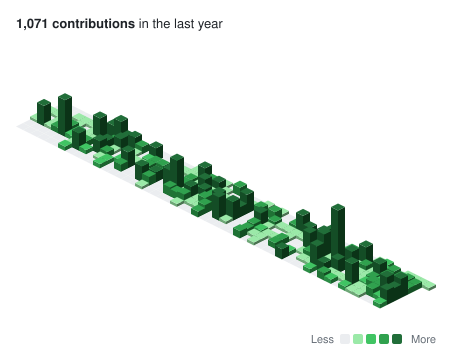
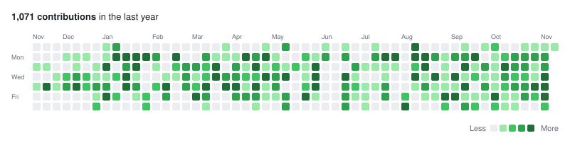
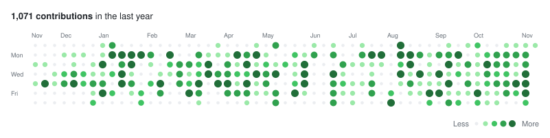
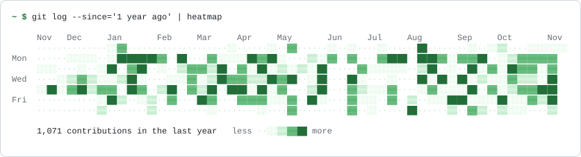
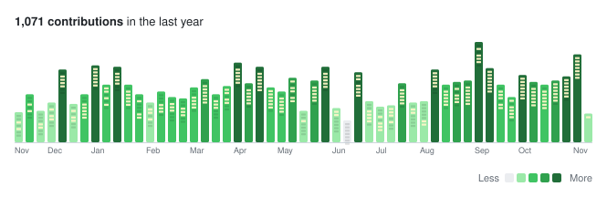
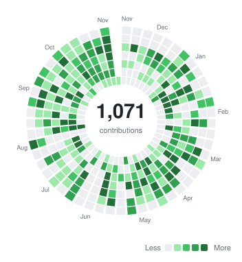
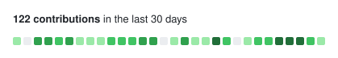

<div align="center">


# contrib/graphs

_Contribution graph components for React: GitHub-style activity heatmaps in seven designs._

[Live demo](https://ingfranciscastillo.github.io/contrib-graphs/) • [Features](#features) • [Installation](#installation) • [Usage](#usage) • [Variants](#variants) • [Data sources](#data-sources) • [Next.js and Astro](#nextjs-and-astro) • [Development](#development)

<picture>
  <source media="(prefers-color-scheme: dark)" srcset="docs/images/isometric-dark.svg">
  
</picture>

</div>

Show your activity on your site or portfolio with a graph that fits its design. Every variant takes the same `{ date, count }[]` data, so you can plug in GitHub, GitLab or anything you track, and switch designs by changing one line.

## Features

- **Seven designs**: Classic, Dots, Isometric, Terminal, Radial, Skyline and Compact.
- **Themes**: six presets with light and dark palettes, or your own theme through an object or CSS variables.
- **Accessible**: a single tab stop with arrow-key navigation, announced days and a text summary. Respects `prefers-reduced-motion`.
- **Responsive**: drops the oldest weeks on narrow screens instead of scrolling, or scales to fit.
- **Server rendering**: components are marked `"use client"` for Next.js, and the data helpers have no React dependency.
- **Data adapters** for GitHub, GitLab, plain dates and merged sources.
- **Localizable**: dates and numbers through `Intl`, every label as a prop.

## Installation

```bash
npm install contrib-graphs
```

React 18 or later is the only dependency.

## Usage

Import a graph and the stylesheet once, for example in your layout or entry file:

```tsx
import { ClassicGraph } from 'contrib-graphs'
import 'contrib-graphs/styles.css'

const data = [
  { date: '2026-11-10', count: 4 },
  { date: '2026-11-11', count: 9 },
]

export function Activity() {
  return <ClassicGraph data={data} theme="github" animate />
}
```

Dates use the ISO format `YYYY-MM-DD` and are read as UTC. Missing days count as 0 and duplicate dates are added up.

## Variants

Every graph accepts the shared props (`data`, `theme`, `colorMode`, `weeks`, `endDate`, `locale`, `onDayClick`…) plus its own. The [API reference](https://ingfranciscastillo.github.io/contrib-graphs/docs/api) lists all of them, and the [playground](https://ingfranciscastillo.github.io/contrib-graphs/variants/classic) lets you try them.

### `ClassicGraph`

<picture>
  <source media="(prefers-color-scheme: dark)" srcset="docs/images/classic-dark.svg">
  
</picture>

### `DotsGraph`

Circles whose size also encodes intensity, so it still reads in monochrome.

<picture>
  <source media="(prefers-color-scheme: dark)" srcset="docs/images/dots-dark.svg">
  
</picture>

### `TerminalGraph`

Real monospace text with several character sets and a custom prompt.

<picture>
  <source media="(prefers-color-scheme: dark)" srcset="docs/images/terminal-dark.svg">
  
</picture>

### `SkylineGraph`

One building per week, as tall as its total, with a lit window for each active day.

<picture>
  <source media="(prefers-color-scheme: dark)" srcset="docs/images/skyline-dark.svg">
  
</picture>

<table>
  <tr>
    <th><code>RadialGraph</code></th>
    <th><code>CompactGraph</code></th>
  </tr>
  <tr>
    <td>
      <picture>
        <source media="(prefers-color-scheme: dark)" srcset="docs/images/radial-dark.svg">
        
      </picture>
    </td>
    <td valign="top">
      <picture>
        <source media="(prefers-color-scheme: dark)" srcset="docs/images/compact-dark.svg">
        
      </picture>
      <p>A single row with the last N days and the current streak, for headers, cards and footers.</p>
    </td>
  </tr>
</table>

## Data sources

The data helpers live in `contrib-graphs/data`, which has no React dependency:

```ts
import { fetchGitHubContributions, fetchGitLabContributions, fromDates, mergeSources } from 'contrib-graphs/data'

const github = await fetchGitHubContributions('your-username', process.env.GITHUB_TOKEN!)
const gitlab = await fetchGitLabContributions('your-username')
const posts = fromDates(blogPosts.map((post) => post.publishedAt))

const data = mergeSources(github, gitlab)
```

> [!IMPORTANT]
> GitHub's GraphQL API needs a token even for public profiles, and GitLab's endpoint sends no CORS headers. Call both from the server or at build time, and never send the token to the browser. A classic token with the `read:user` scope includes private contributions.

## Next.js and Astro

The components entry starts with `"use client"`, so you can render graphs straight from a Server Component and fetch the data on the server:

```tsx
// app/page.tsx
import { ClassicGraph } from 'contrib-graphs'
import { fetchGitHubContributions } from 'contrib-graphs/data'

export default async function Page() {
  const data = await fetchGitHubContributions('your-username', process.env.GITHUB_TOKEN!)
  return <ClassicGraph data={data} endDate={data.at(-1)?.date} />
}
```

In Astro with `@astrojs/react`, a graph without a directive ships as static HTML with no JavaScript; add `client:visible` for tooltips and keyboard navigation.

> [!TIP]
> When rendering on the server, always pass `endDate` (for real data, the last date in it). The server and the browser may be on different days, which would cause a hydration mismatch.

## Development

This repository is an npm workspace with the package and its documentation site:

```
packages/contrib-graphs/   the contrib-graphs package (tsdown: ESM, CJS and types)
apps/site/                 gallery, playground and docs (Vite, React, TanStack Router), in English and Spanish
docs/images/               README images, generated from the components
```

It needs Node 20.19 or later (`nvm use` reads `.nvmrc`).

```bash
npm install
npm run dev        # site at http://localhost:5173, using the package source
npm test           # types, package tests (Vitest) and script tests (node --test)
npm run build      # builds the package, then the site against the built package
```

Some files are generated, and a test fails when they get out of date:

| Command | Updates |
| --- | --- |
| `npm run api` | The API reference, from the package types |
| `npm run images` | The README images in `docs/images`, from the components |
| `npm run data` | The site's real GitHub data (see `apps/site/.env.example`) |

> [!NOTE]
> If `npm install` fails with `Cannot read properties of null (reading 'edgesOut')`, use npm 11: `npx npm@11 install`.
