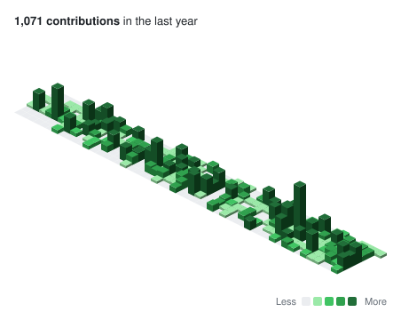

# contrib-graphs



Contribution graph components for React: GitHub-style activity heatmaps in seven designs (Classic, Dots, Isometric, Terminal, Radial, Skyline, Compact), with themes, light/dark mode, keyboard navigation and screen reader support.

```bash
npm install contrib-graphs
```

```tsx
import { ClassicGraph } from 'contrib-graphs'
import 'contrib-graphs/styles.css'

const data = [
  { date: '2026-11-10', count: 4 },
  { date: '2026-11-11', count: 9 },
]

export function Activity() {
  return <ClassicGraph data={data} theme="github" animate />
}
```

Every component takes the same `{ date, count }[]` data. Adapters for GitHub and GitLab (`fromGitHub`, `fromGitLab`, `fetchGitHubContributions`, `fetchGitLabContributions`) and generic sources (`fromDates`, `mergeSources`) are included.

Requires React 18 or later.

Prefer to own the code? Copy any variant into your project with the shadcn CLI instead of installing the package:

```bash
npx shadcn@latest add https://ingfranciscastillo.github.io/contrib-graphs/r/classic-graph.json
```

## Next.js, Astro and server rendering

- `contrib-graphs` exports the components and starts with `"use client"`, so you can render them straight from a Next.js Server Component.
- `contrib-graphs/data` exports everything else (calendar helpers, themes, adapters, sample data) with no React dependency. Use it on the server, for example `fetchGitHubContributions` in a Server Component or an Astro page.
- In Astro (with `@astrojs/react`), a graph without a `client:*` directive ships as static HTML with no JavaScript; add `client:visible` for tooltips and keyboard navigation. Functions can't be passed to islands, so wrap the graph in a React component to use `onDayClick`.
- When rendering on the server, pass `endDate` (for real data, the last date in it): the server and the browser may be on different days. Dates and numbers default to the `en` locale on both sides.

```tsx
// app/page.tsx (Next.js)
import { ClassicGraph } from 'contrib-graphs'
import { fetchGitHubContributions } from 'contrib-graphs/data'

export default async function Page() {
  const data = await fetchGitHubContributions('your-username', process.env.GITHUB_TOKEN!)
  return <ClassicGraph data={data} endDate={data.at(-1)?.date} />
}
```

Tested with Next.js 16 (React 19) and Astro 6.

Live gallery, playground and full API reference: [ingfranciscastillo.github.io/contrib-graphs](https://ingfranciscastillo.github.io/contrib-graphs/). Source and more designs: [github.com/ingfranciscastillo/contrib-graphs](https://github.com/ingfranciscastillo/contrib-graphs).

## License

MIT
